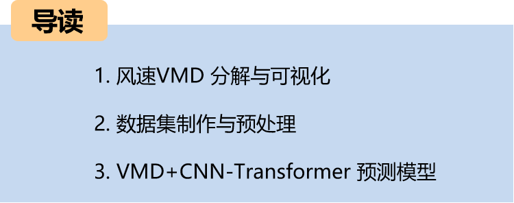
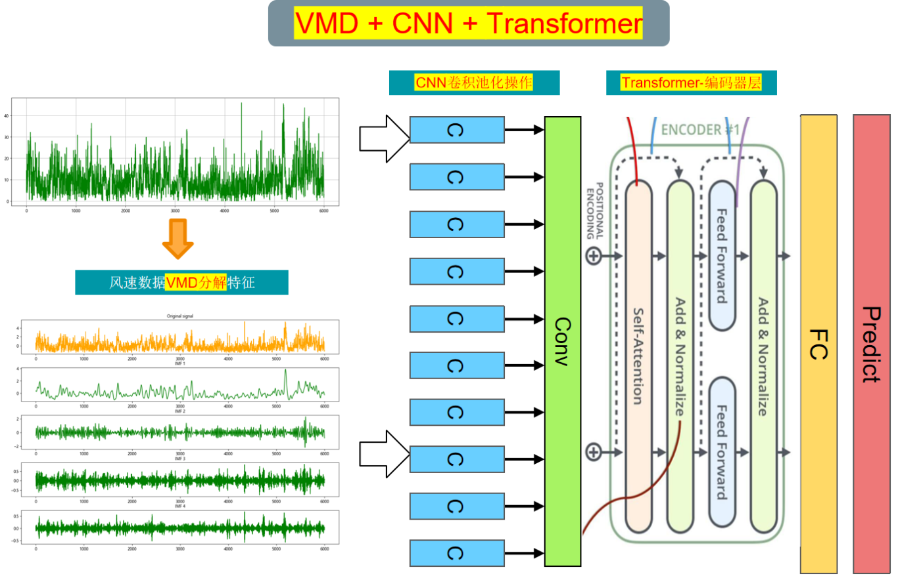
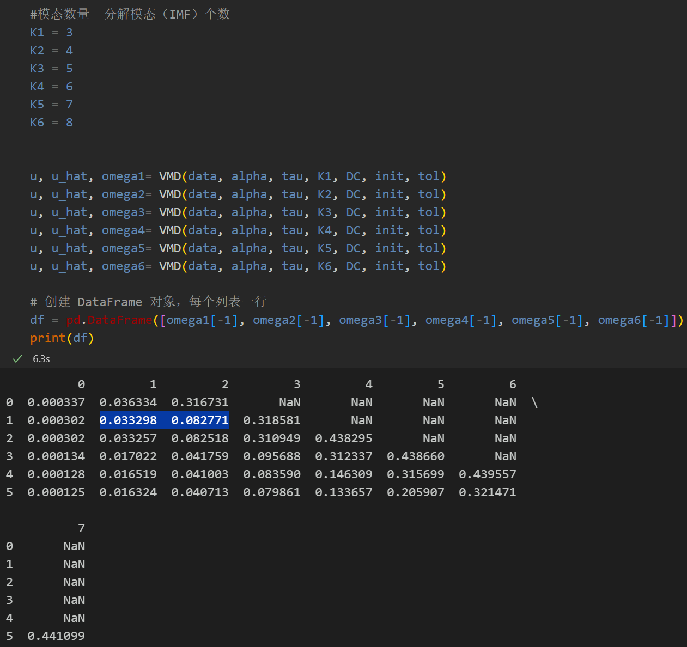
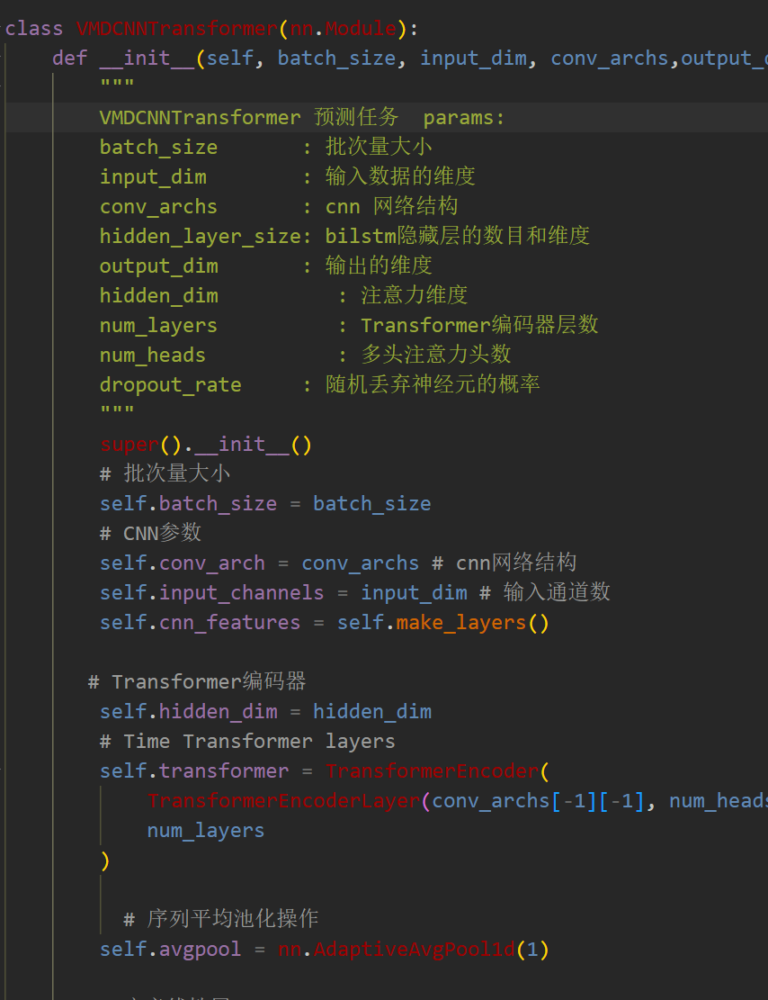
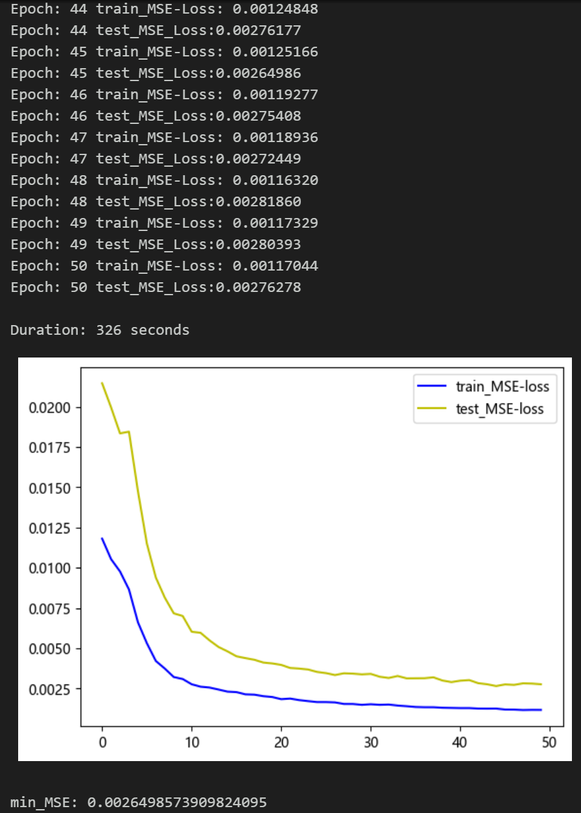
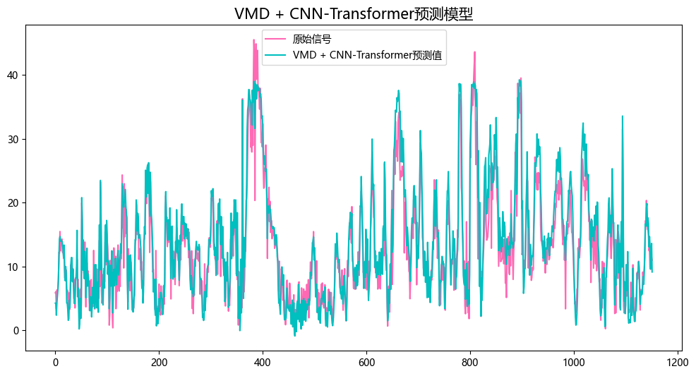
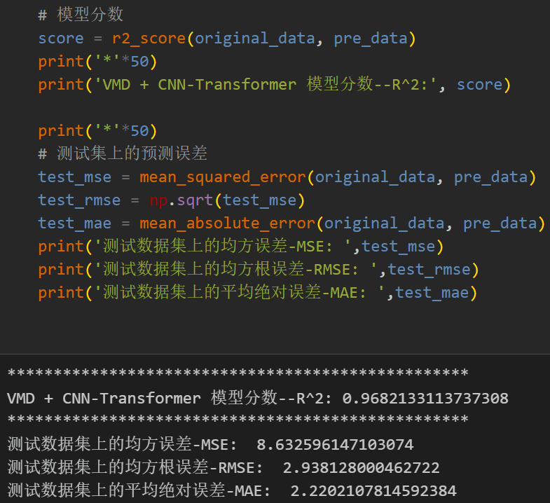
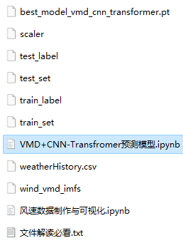

# (Single Step) VMD-CNN-Transformer Predictive Model

Multi-feature variables include the following:
Preface
This article is based on the wind speed data introduced earlier (Appendix at the end for the dataset), which first undergoes VMD decomposition, followed by data preprocessing to create and load the dataset and labels. Finally, a Pytorch-based VMD-CNN-Transformer model is implemented to predict wind speed data, aiming to enhance the prediction performance of time series data. For detailed introductions to the wind speed dataset, please refer to the following section:
Wind Speed Prediction (Part I): Dataset Introduction and Preprocessing
Overall Model Structure: The VMD algorithm is used to decompose the wind speed sequence into components, forming input features through sliding windows. These components are then predicted using CNN-Transformer models, extracting component space and temporal features before being fed into fully connected layers to achieve high-precision prediction models.
1 Wind Speed VMD Decomposition and Visualization
1.1 Import Data
1.2 VMD Decomposition
Step 1: Mode selection
Based on different K values, observe central frequencies; select the K value that yields similar central frequencies; starting from K=4, multiple modes with similar central frequencies appear, indicating overdecomposition, hence choosing K=4 for the number of modes.
Step 2: Visualization of Wind Speed Data VMD Decomposition
2. Data Preparation and Preprocessing
Firstly, divide the dataset into training and testing sets in an 8:2 ratio.
When dealing with LSTF issues, selecting an appropriate window size is crucial. A suitable window size can help the model better capture patterns and features within the time series. To extract longer dependencies for modeling, this paper increases the window size to 48 and employs the VMDEncoder + CNN-Transformer model to fully extract feature information from the sequence.
3 VMDEncoder + CNN-Transformer Prediction Model Based on Pytorch
3.1 Definition of the VMD + CNN--Transformer Predictive Model
Note: The input wind speed data shape is [64, 48, 4], batch_size=64, where 48 represents the sequence length (the sliding window takes values), and the dimension of 4 represents the four components features extracted by VMD decomposition.

3.2 Set parameters and train the model
50 epochs, MSE is 0.002649, the VMD + CNN-Transformer model has a good predictive effect. After adding VMD decomposition, the prediction performance of the sequence has been significantly improved, with superior performance. By appropriately adjusting the model parameters, further improvement in the model's predictive performance can be achieved.

Note to adjust parameters:
- It may be appropriate to increase the number of CNN layers and hidden layer dimensions, adjust learning rate;
- Adjust the number of Transformer encoder layers and attention dimensions/multi-head attention heads, increase more epochs (note to prevent overfitting);
- Change the sliding window length (set an appropriate window length)

4 Model Evaluation and Visualization
4.1 Results Visualization
4.2 Model Evaluation
Previously interesting content:
Time series forecasting: Analysis and comparison of LSTM, ARIMA, Holt-Winters, SARIMA models
Wind Speed Forecasting (I): Data set introduction and preprocessing
Wind Speed Forecasting (II): EMD-LSTM model based on Pytorch
Wind Speed Forecasting (III): EMD-LSTM-Attention model
Wind Speed Forecasting (IV): EMD-Transformer model based on Pytorch
Wind Speed Forecasting (V): EMD-CNN-LSTM model based on Pytorch
Wind Speed Forecasting (VI): EMD-CNN-GRU parallel model based on Pytorch
CEEMDAN + Combination Prediction Model (BiLSTM-Attention + ARIMA)
CEEMDAN + Combination Prediction Model (CNN-LSTM + ARIMA)
CEEMDAN + Combination Prediction Model (Transformer - BiLSTM + ARIMA)
CEEMDAN + Combination Prediction Model (CNN-Transformer + ARIMA)
Multi-Feature Variable Sequence Forecasting (I) - CNN-LSTM Wind Speed Forecasting Model
Multi-Feature Variable Sequence Forecasting (II) - CNN-LSTM-Attention Wind Speed Forecasting Model
Multi-Feature Variable Sequence Forecasting (III) - CNN-Transformer Wind Speed Forecasting Model
Multi-Feature Variable Sequence Forecasting (IV) Transformer-BiLSTM Wind Speed Forecasting Model
Multi-Feature Variable Sequence Forecasting (V) CEEMDAN+CNN-LSTM Wind Speed Forecasting Model
Multi-Feature Variable Sequence Forecasting (VI) CEEMDAN+CNN-Transformer Wind Speed Forecasting Model
Prediction Model Based on the Particle Swarm Optimization Algorithm SSA - CEEMDAN-BiLSTM-Attention
Prediction Model Based on the Particle Swarm Optimization Algorithm SSA - CEEMDAN-Transformer-BiGRU
Superior Prediction Model: Secondary Decomposition-Combination Prediction
Multi-Feature Variable Sequence Forecasting (VII) CEEMDAN+Transformer-BiLSTM Forecasting Model
Multi-Feature Variable Sequence Forecasting (VIII) Prediction Model Based on the Particle Swarm Optimization Algorithm - CEEMDAN-SSA-BiLSTM Forecasting Model

## Images

<!-- PAYMENT_BLOCK -->

## Get this dataset

- Payment link (Stripe): [Buy now](https://buy.stripe.com/3cs8yP7sY87d0vu9AB)
- Payment QR code: 

<!-- /PAYMENT_BLOCK -->
